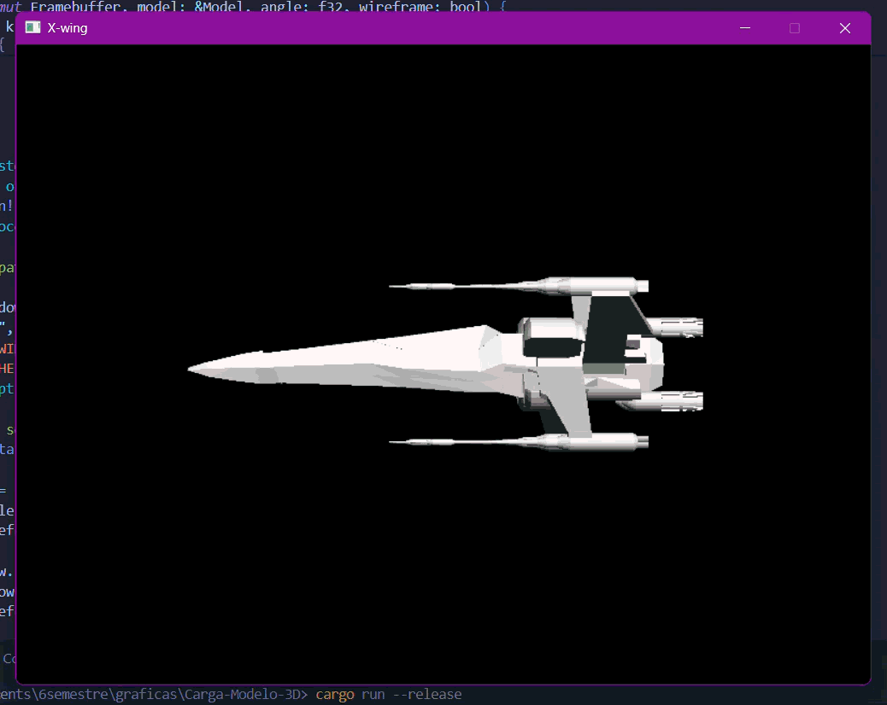

# Carga-Modelo-3D

Renderizador en Rust que carga un modelo 3D desde un archivo `.obj` usando triangulos



## Modelo

Es un X-Wing (starwars) creado en **Blender** y exportado como `.obj` con las caras **trianguladas**. El cargador solo acepta triángulos: si una cara tiene más de 3 vértices, el programa muestra un error. Al exportar desde Blender hay que activar **Triangulate Faces**.

El archivo está en [assets/xwing.obj](assets/xwing.obj).

## Ejecución

```bash
cargo run
```

o

```bash
cargo run --release
```

Para cargar otro modelo:

```bash
cargo run --release -- ruta/al/modelo.obj
```

## Controles

| Tecla | Acción |
|-------|--------|
| `W`   | Cambia entre vista rellena y vista wireframe |
| `Esc` | Cierra la ventana |


## Cómo funciona

El modelo se renderiza en Rust dibujando triángulos, sin usar ninguna librería gráfica de 3D:

- [src/obj.rs](src/obj.rs): lee los vértices (`v`) y las caras (`f`) del `.obj`.
- [src/triangle.rs](src/triangle.rs): dibuja cada triángulo, relleno (coordenadas baricéntricas) o solo el contorno.
- [src/line.rs](src/line.rs): líneas con el algoritmo de Bresenham, usadas en el wireframe.
- [src/framebuffer.rs](src/framebuffer.rs): buffer de píxeles y z-buffer.
- [src/main.rs](src/main.rs): ventana, transformación del modelo y bucle de render.

